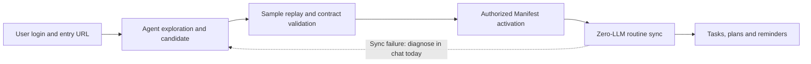

# Academic Agent

[English](README.en.md) | [中文](README.md)

**Keep courses, assignments and exams together. Spend less time checking portals.**

Academic Agent runs on your computer. It brings courses, assignments and exams from school platforms into one place, saves your progress, and plans study time around your availability. You can also import course materials and ask the Agent to find relevant passages, explain a problem or suggest what to review.

Routine sync, deduplication, reminders and basic planning run without model calls. For an unsupported site, you can ask the Agent in a DSH conversation to inspect its pages and draft connection rules. Once those rules are validated and authorized, later syncs reuse them.

Business data stays on your machine by default, and credentials go into the system credential vault. Important changes have sources and history; you can pause automation, confirm plans and lock study blocks.

## Connect a school platform

Schools differ in their sites, APIs and page structures. Academic Agent captures those differences in a verifiable **Manifest: declarative connection rules**. Existing engines execute the rules, with configuration as the first choice for new integrations.

1. **Observe the real site**: after you log in, the Agent uses controlled tools to probe pages and crawl a limited section, looking for lists, fields, pagination and endpoint clues. HTML, JSON and explicitly declared read-only JSON POST requests are supported.
2. **Generate candidate rules**: in a DSH conversation, the Agent turns its findings into a Manifest declaring the hosts, paths, courses and academic fields to read. Candidates can be staged for review.
3. **Test the inference against samples**: offline replay checks the rule structure, field contracts and access scope against real page / JSON samples. Host-captured samples can be referenced by `sampleId`, keeping raw responses out of the model context.
4. **Authorize and reuse**: only validated versions can be enabled. Activation creates or updates a sync source; a deterministic runtime then executes its rules without reasoning about the site structure on every run.



**Working example: USTC exam schedules.** The integration added one Manifest, two fixtures and an integration test suite to read exam information, without changing the kernel, Connector or UI, or adding a platform-specific engine. See [real-source verification](docs/real-sources.md) for its scope.

Adaptation also applies to your schedule: changes to deadlines, task progress or availability can produce revised plan suggestions, preserving locked blocks and explaining work that cannot fit.

## When a school site changes

The system retains **verifiable connection rules, candidate versions and validation records**. When a site changes, failure information can guide another probe, a new rule version, replay validation and activation. Previous versions remain available for rollback. Rule versions are managed separately from academic facts; failed syncs preserve existing data and your progress.

| Stage | Current status |
|---|---|
| Probe → candidate → validate → enable / rollback | Implemented; the Agent generates candidates in a DSH conversation |
| Enable → live preview / sync | Implemented; enabling “Agent auto-connect” in Settings lets the Agent complete these steps within its authorized scope, without per-call approval |
| Diagnose → revise rules → validate a new version | Currently performed through a user-initiated Agent conversation using the available tools |
| Automatically invoke the Agent and repair failed syncs | Future goal; unattended self-repair is not implemented |

**Passing sample replay establishes that rules parse the supplied samples. Live preview, live sync and a repeat sync producing no changes need separate verification.** See [MVP verification](docs/mvp-verification.md) and the [roadmap](doc/ACADEMIC_AGENT_ROADMAP_MVP_FIRST.md) for implementation status.

“Agent auto-connect” is off by default and can be disabled at any time. It only permits activating validated candidates and previewing or syncing declarative sources. Other writes, such as task changes, still require per-call authorization from the trusted host. The Agent never receives cookies or tokens, submits homework or changes your school account.

## Daily use: automate the work with known rules

- **Collect courses and deadlines**: tested with Blackboard courses / assignments and USTC exam schedules, with manual entry available. Repeated syncs do not duplicate courses; matching names within a term reuse the same course identity.
- **Plan study time**: use deadlines, task and course priorities, and your available hours; confirm plans, lock blocks and inspect conflicts.
- **Get deadline reminders**: local 72-hour / 24-hour scans by default, with deduplication and catch-up checks after restart.
- **Search course materials**: import PDF, PPTX, DOCX, web pages or text; keyword results provide titles, excerpts and available page numbers for Agent citations. Scanned PDFs do not yet support OCR.
- **Ask for queries and explanations**: use course, task, plan and material tools in DSH chat. The Tutor skill requires material lookup and source attribution, and disclosure when material is missing.
- **Keep results across sessions**: data, configuration, plans and background jobs are recoverable. While the host is running, routine automation operates independently of Agent sessions. Disabling the Agent or UI plugin preserves academic facts.

## Quick start

Requires Node.js ≥ 22.12. The credential vault currently uses Windows DPAPI.

```bash
npm ci
npm run build:dsh
npm run build:ui

# Run the built-in demo: sync → tasks → plan
ACADEMIC_DB=.data/academic.db npm run demo
```

Typical first run: **add a course → connect/sync → `list` your tasks → `plan --accept` → import materials**. The demo walks through this flow with fixture data.

Common commands:

```bash
npm run demo -- list                         # what is due today / soon
npm run demo -- course add 2026-fall CS101 "Computer Science"
npm run demo -- task add "Review chapter 3" --minutes 60
npm run demo -- plan --accept                # generate and confirm a 7-day plan
npm run demo -- material add notes.pdf --course <courseId>
npm run demo -- material search "implicit function"
npm run demo -- help
```

See the [CLI reference](docs/cli.md) (Chinese) for every command. The default database is `.data/academic.db`; override it with `ACADEMIC_DB`.

## Use inside DSH (optional)

Requires DSH `0.2.1-rc.3`. Install the host/tools bundle:

```bash
dsh plugin --profile academic add <path-to-repo>/packages/academic-dsh-plugin
```

Install the “Academic” UI for DSH Web or Desktop:

```bash
dsh plugin --profile academic-web add \
  <path-to-repo>/packages/academic-dsh-plugin \
  <path-to-repo>/packages/academic-dsh-ui
```

The UI is grouped into Daily (Today, Tasks, Plan, Courses, Materials) and Manage (Connections, Automation, Settings). Today leads with the next confirmed block, today's tasks and overdue work; each course page aggregates tasks, sources and materials.

The Agent is read-only by default. Writes such as changing tasks or importing/deleting materials require per-call approval from the trusted host. Without a DSH approval UI, those writes are rejected; CLI and direct UI actions still work. The “Agent auto-connect” setting described above is a separate, limited user authorization for validated candidate activation and declarative source preview / sync.

DSH has no official central market; its Discover page reads index URLs configured by the user. The Academic Agent index is:

```text
https://kw78.github.io/academic-agent/market/index.json
```

See [market/README.md](market/README.md) for setup.

Install details: [plugin README](packages/academic-dsh-plugin/README.md), [UI README](packages/academic-dsh-ui/README.md).

## Where data lives

- Database: `.data/academic.db` for CLI; `$DSH_HOME/academic-agent/academic.db` for DSH.
- Materials: a `materials/` directory beside the database, content-addressed; SQLite stores only metadata and search chunks.
- Credentials: Windows DPAPI; no plaintext cookies or tokens in the database, logs or Agent results.
- Backup: `backup` snapshots SQLite only; `backup-app` also captures `materials/` with a SHA-256 manifest — use it when moving the whole library.
- Deletion, recovery and troubleshooting: [operations guide](docs/operations.md) (Chinese).

## Known limitations

- The credential vault currently supports Windows DPAPI only.
- No OCR for scanned PDFs; only the original file is kept.
- Automatic attachment import scans only the single course page you provide, never the whole site.
- Blackboard covers courses, assignments and folders; real exam/quiz samples are still validated with sanitized fixtures.
- DSH file-level HMR, real Session lifecycle and the full approval UI are not yet specifically verified.
- npm packages are not officially published yet; install from source or local tarballs.

Full acceptance boundaries: [MVP verification](docs/mvp-verification.md); architecture and engineering status: [AGENTS.md](AGENTS.md). These detailed documents are currently in Chinese.

## Documentation

- [CLI reference](docs/cli.md)
- [Operations, backup and troubleshooting](docs/operations.md)
- [Testing and architecture matrix](docs/testing.md)
- [Frontend verification](docs/frontend-verification.md)
- [Architecture decisions](docs/adr)
- [Roadmap](doc/ACADEMIC_AGENT_ROADMAP_MVP_FIRST.md)
- [v0.2.0 release notes](docs/releases/v0.2.0.md)
- Architecture baseline: [Intent](doc/Academic_Agent_Intent_v1.0.md), [Architecture Spec](doc/Academic_Agent_Architecture_Spec_v0.1-1.md)

## License

Apache License 2.0. See [LICENSE](LICENSE). Third-party dependencies keep their own licenses.
