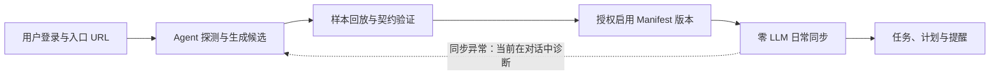

# Academic Agent

[中文](README.md) | [English](README.en.md)

**把课程、作业和考试放在一起，少花时间来回查。**

Academic Agent 是一个在本机运行的学业助手。它汇总学校平台上的课程、作业和考试，保存你的学习进度，并根据空闲时间安排计划。你也可以导入课件和讲义，在需要时请 Agent 查资料、讲题或给复习建议。

日常同步、去重、提醒和基础规划都由程序完成，不调用大模型。遇到尚未支持的网站时，可以在 DSH 对话中让 Agent 帮忙分析页面、生成接入规则；规则经过验证并获准启用后，后续同步就能重复使用。

业务数据默认留在本机，凭据只进系统凭据库；重要变化有来源和历史，用户可以暂停自动化、确认或锁定计划。

## 接入学校平台

不同学校的网站、接口和页面结构各不相同。Academic Agent 将这些差异保存在可验证的 **Manifest（声明式接入规则）** 中，让已有引擎承担执行，新平台优先通过配置接入。

1. **观察真实网站**：用户完成登录后，Agent 通过受控工具探测页面、有限抓取栏目，寻找列表、字段、分页与接口线索；支持 HTML / JSON，以及显式声明的只读 JSON POST。
2. **生成候选规则**：Agent 在 DSH 对话中将发现整理为 Manifest，声明读取哪些主机、路径、课程和学业字段。候选可以暂存，供用户查看。
3. **用样本检验推断**：在真实页面 / JSON 样本上离线回放，检查规则结构、字段契约与访问范围；宿主捕获的样本可通过 `sampleId` 引用，原始响应无需交给模型。
4. **授权后持续复用**：只有验证通过的版本才能启用；启用会创建或更新同步源，后续由确定性运行时按规则执行，无需每轮重新推理网站结构。



**已有实例：USTC 教务考试接入。** 新增一个 Manifest、两个 fixture 和一组集成测试，即可读取考试信息；无需修改内核、Connector 或 UI，也无需新增网站专属引擎。覆盖范围见 [真实数据源验证](docs/real-sources.md)。

自适应也体现在日常安排中：截止时间、任务进度或可用时间改变后，系统可以重新计算计划建议，保留用户锁定的时间块，并说明无法安排的冲突。

## 网站改版后怎么处理

系统积累的是**可验证的接入规则、候选版本和验证记录**。网站变化后，可以结合失败信息重新探测、生成新版本、回放验证，再切换生效版本；旧版本保留，可回滚。规则演进与学业事实分开管理，同步失败会保留已有数据和用户进度。

| 环节 | 当前进展 |
|---|---|
| 探测 → 候选 → 验证 → 启用 / 回滚 | 已实现；候选生成由 DSH 对话中的 Agent 完成 |
| 启用 → 真实预览 / 同步 | 已实现；设置页开启“Agent 自动接入”后，Agent 可在授权范围内完成，无需逐次审核 |
| 失败诊断 → 修改规则 → 新版本验证 | 目前由用户发起 Agent 对话，结合现有工具完成 |
| 同步失败自动唤起 Agent 并修复 | 后续目标；尚未实现无人值守的自修复闭环 |

**样本回放通过只说明规则能解析给定样本；真实预览、真实同步与重复同步 no-op 需要分别验证。** 当前能力与进展详见 [MVP 验收](docs/mvp-verification.md) 和 [路线图](doc/ACADEMIC_AGENT_ROADMAP_MVP_FIRST.md)。

“Agent 自动接入”默认关闭，用户可随时关闭；开启后也仅允许启用已验证候选、预览和同步声明式数据源。任务修改等其他写入仍需可信宿主逐次授权。Agent 不获得 Cookie / Token，也不会替你提交作业或修改学校账户。

## 平时可以用它做什么

- **汇总课程和待办**：已实测 Blackboard 课程 / 作业与 USTC 教务考试，也可手动添加。重复同步不会重复建课，同学期同名课程复用同一身份。
- **安排学习时间**：按截止时间、任务及课程优先级和你设置的空闲时间规划；支持计划确认、锁定和冲突说明。
- **截止前提醒**：默认本地扫描 72 小时 / 24 小时提醒，去重并在重启后补偿检查。
- **检索课件和讲义**：导入 PDF、PPTX、DOCX、网页或文本后按关键词检索；提供资料标题、片段和可用页码，供 Agent 引用。扫描版 PDF 暂无 OCR。
- **按需查询与讲解**：在 DSH 对话中使用课程、任务、计划和资料工具；Tutor skill 约束讲解先查资料、标注来源，缺少资料时明确说明。
- **跨会话保留成果**：数据、配置、计划和后台作业可恢复；宿主运行时，例行自动化独立于 Agent 会话。停用 Agent 或 UI 插件仍保留学业事实。

## 最短上手

要求 Node.js ≥ 22.12；凭据库目前使用 Windows DPAPI。

```bash
npm ci
npm run build:dsh
npm run build:ui

# 用内置演示数据跑通：同步 → 任务 → 计划
ACADEMIC_DB=.data/academic.db npm run demo
```

第一次完整使用可以按这个顺序：**添加课程 → 连接/同步 → `list` 看任务 → `plan --accept` 确认计划 → 导入资料**。`demo` 会用内置数据把这条链路跑一遍。

常用操作：

```bash
npm run demo -- list                         # 看今天/近期要做什么
npm run demo -- course add 2026-fall CS101 "Computer Science"
npm run demo -- task add "复习第三章" --minutes 60
npm run demo -- plan --accept                # 生成并确认未来 7 天计划
npm run demo -- material add notes.pdf --course <courseId>
npm run demo -- material search "隐函数"
npm run demo -- help
```

完整命令见 [CLI 参考](docs/cli.md)。数据库默认在 `.data/academic.db`，可用 `ACADEMIC_DB` 改路径。

## 在 DSH 里使用（可选）

需要 DSH `0.2.1-rc.3`。只装 Host/工具：

```bash
dsh plugin --profile academic add <path-to-repo>/packages/academic-dsh-plugin
```

同时装“学业”界面（Web 或 Desktop）：

```bash
dsh plugin --profile academic-web add \
  <path-to-repo>/packages/academic-dsh-plugin \
  <path-to-repo>/packages/academic-dsh-ui
```

界面分为“日常学习”（今天、任务、计划、课程、资料）和“管理”（连接、自动化、设置）；今天页先显示下一学习时段、今日任务与逾期，课程页汇总任务、来源和资料。

Agent 默认只读；修改任务、导入/删除资料等写入必须由可信宿主逐次批准。当前没有接入 DSH 审批弹窗时，这些写入会被拒绝，CLI/UI 操作不受影响。上文的“Agent 自动接入”是用户单独开启的有限授权，仅覆盖已验证候选启用和声明式源的预览 / 同步。

DSH 没有官方中央市场；插件 Discover 读取用户配置的索引。Academic Agent 索引：

```text
https://kw78.github.io/academic-agent/market/index.json
```

添加方式见 [market/README.md](market/README.md)。

安装细节：[插件 README](packages/academic-dsh-plugin/README.md)、[UI README](packages/academic-dsh-ui/README.md)。

## 数据放在哪里

- 数据库：CLI 默认 `.data/academic.db`；DSH 默认 `$DSH_HOME/academic-agent/academic.db`。
- 课程资料：数据库同目录的 `materials/`，按内容哈希保存；SQLite 只存元数据和检索分块。
- 凭据：Windows DPAPI；数据库、日志和 Agent 结果里没有明文 Cookie/Token。
- 备份：`backup` 只快照 SQLite；`backup-app` 连同 `materials/` 与 SHA-256 清单一起备份，整库迁移用后者。
- 删除/恢复与故障处理见 [运维文档](docs/operations.md)。

## 已知限制

- 凭据库目前只支持 Windows DPAPI。
- 扫描版 PDF 没有 OCR，只能保存原件。
- 自动附件导入只扫描你给出的单个课程页，不做全站爬虫。
- Blackboard 已覆盖课程/作业/文件夹；真实考试/测验样本仍以脱敏 fixture 验证。
- DSH 文件级 HMR、真实 Session 生命周期和完整审批 UI 尚未专项验证。
- npm 包尚未正式发布；当前从源码或本地 tarball 安装。

更完整的验收边界见 [MVP 验收](docs/mvp-verification.md)，架构与工程状态见 [AGENTS.md](AGENTS.md)。

## 文档

- [CLI 参考](docs/cli.md)
- [运维、备份与故障处理](docs/operations.md)
- [测试与架构矩阵](docs/testing.md)
- [前端验证记录](docs/frontend-verification.md)
- [架构决策](docs/adr)
- [当前路线图](doc/ACADEMIC_AGENT_ROADMAP_MVP_FIRST.md)
- [v0.2.0 发布说明](docs/releases/v0.2.0.md)
- 架构基线：[Intent](doc/Academic_Agent_Intent_v1.0.md)、[Architecture Spec](doc/Academic_Agent_Architecture_Spec_v0.1-1.md)

## License

Apache License 2.0。见 [LICENSE](LICENSE)；第三方依赖保留各自许可证。
