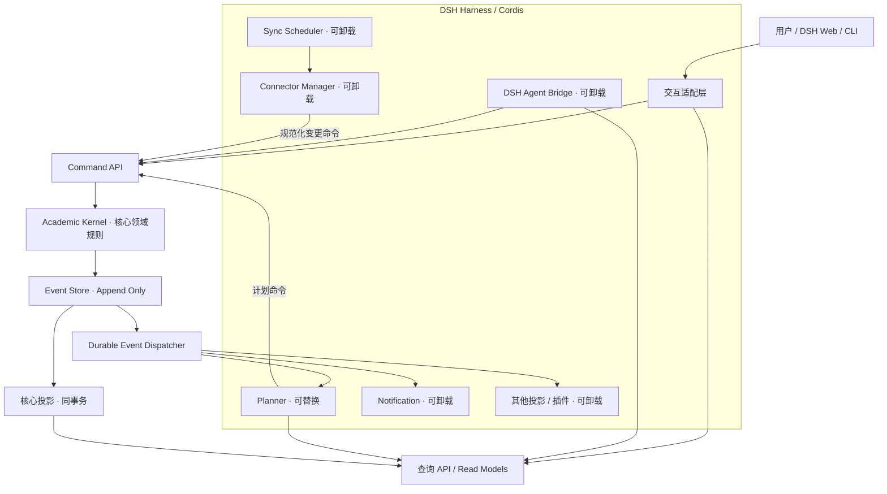

# Academic Agent — 系统架构设计规范（Architecture Spec）

> **版本：** v0.1 · Architecture Baseline / Draft  
> **日期：** 2026-10-27  
> **对应需求：**《可扩展个人学业助手 PRD v0.2》  
> **目标：** 先实现单用户学业管理 MVP；长期演进为通用、个性化、可扩展的个人自动化助手。  
> **说明：** 文中 `academic.*`、TypeScript 接口、SQL 表均为**本项目拟定义的契约和设计草案**，不代表 DSH 已经原生提供同名 API。与 DSH 的实际适配需要按锁定版本编译、测试确认。

---

# 第一部分：宏观抽象架构

## 1. 设计意图与不变量

### 1.1 一句话架构

在 **DSH Harness / Cordis** 之上，以**事件溯源的最小学业领域内核**保存和解释业务事实，通过**可卸载的能力插件**组织数据接入、自动化调度、规划、通知与教学；**常规任务使用确定性程序，只有需要推理或探索的任务才进入 Agent**。

### 1.2 六条不可违反的架构原则

1. **Automation First**：抓取、同步、去重、排序、提醒与基础规划默认不调用 LLM。
2. **Stable Kernel**：内核只拥有长期稳定的领域规则、命令校验、事件事实与基础查询；不内置具体网站、算法、UI 或模型。
3. **Event as Source of Truth**：核心业务事实以不可变领域事件为权威来源；查询投影可重建。
4. **Extension by Contract**：插件依赖稳定服务契约而非彼此的内部实现；脚本与 Cordis 插件按扩展粒度区分。
5. **Controlled Mutation**：UI、Agent 和自动化插件都不得直接篡改事件存储或核心读模型；状态变更经 Command Handler。
6. **Recoverability**：崩溃、网络故障、重复投递、插件卸载及重启不能静默破坏用户学业状态。

### 1.3 不追求的能力

MVP 不追求通用多 Agent 平台、任意网站全自动适配、自主安装高权限插件、多租户、云端高可用、大规模分布式事件总线、完整工作流引擎或任意外部动作自动执行。

## 2. 分层与模块关系



**注意：** `Event Store` 和 `核心投影` 在 MVP 中使用**同一 SQLite 数据库、同一事务**；图中的箭头是逻辑职责，而不是独立进程。`Durable Event Dispatcher` 从持久化事件表按序拉取并投递，不把普通 Cordis `emit` 当作可靠消息队列。

### 2.1 三类层次

- **Harness 基础设施（复用）**：DSH 的 Agent、Tool、Session、Cordis Service/Event、插件装配和 Bundle 生命周期。
- **Academic Kernel（稳定）**：命令处理、Aggregate、一致性规则、领域事件、当前核心状态与必要查询契约。
- **Feature Providers（可替换）**：数据源、调度、规划、教学、通知、界面及 Agent Bridge。数据源的具体解析器首先是 Adapter，而非必须成为独立的 Cordis 插件。

### 2.2 最小可信基础

逻辑上存在稳定核心，不表示所有核心能力必须装在**单一巨大 npm 包**内。建议将公共契约、内核实现及存储提供者分离，但作为一个**受版本约束的 Core Bundle**整体维护。

普通功能插件可独立禁用；存储提供者只能在停止核心服务、备份并完成迁移后替换。不能承诺拔掉数据库插件后仍能正常处理写命令。

## 3. 已选技术与对比结论（ADR 摘要）

| ADR | 决策 | 放弃或暂缓的方案 | 主要权衡 |
|---|---|---|---|
| 001 | DSH/Cordis 上的微内核式模块化单体 | 从头开发 Agent 框架；全服务拆进程 | 最大化复用，先保持简单 |
| 002 | TypeScript / Node.js，Monorepo | 混用 Python 主干 | 与 DSH/Cordis 接口一致；Python 以后可作脚本工具 |
| 003 | 核心业务 Event Sourcing + 读模型 | CRUD + 审计日志 | 增加事件版本管理成本，换取回放/可审计性 |
| 004 | SQLite Event Store + 关系型投影 | DSH KV Domain；立即 PostgreSQL/KurrentDB | SQLite 事务适合单用户；独立保留迁移可能 |
| 005 | 每聚合事件流 + 全局顺序 | 全系统一条业务聚合流 | 更好的并发与回放控制 |
| 006 | 核心投影与事件同步事务提交 | 全部异步投影 | 保证“写入后立即读到正确状态” |
| 007 | 扩展投影异步、可追赶 | 所有插件写入同一事务 | 内核不被插件阻塞 |
| 008 | 事件存储与运行时 Cordis Event 分离 | 将 `ctx.emit()` 当作持久事件总线 | 生命周期通知与可靠交付分离 |
| 009 | Connector 服务 + 适配脚本 | 每个网站一个 Cordis 插件 | 降低更新、权限、依赖成本 |
| 010 | 内置轻量持久调度器 | 将 Agent Session / `ctx.jobs` 直接用作业务队列 | 会话和运行作业不等于可恢复调度 |
| 011 | 规则化 Planner，Agent 按需补充语义 | 一切由 LLM 排时间 | 可测试、低成本、结果可解释 |
| 012 | 复用 DSH Plugin Manager/HMR | 自建插件 Loader | 避免双重生命周期 |
| 013 | 单用户本地 Profile | 首版多租户 | 降低安全和部署复杂度 |

**升级原则：** ADR 被验证失败时记录替代决策和迁移方案；不能静默修改契约。

---

# 第二部分：内核与领域契约

## 4. Core Bundle 边界

### 4.1 应始终存在的业务能力

- `academic.command`：受控命令处理入口；验证身份、参数、权限、聚合版本、业务不变量。
- `academic.query`：稳定的课程、事项、任务、计划查询接口。
- `academic.events`：事件存储、按流/全局读取、订阅注册；写权限仅向 Kernel Command 侧开放。
- `academic.projections`：核心投影版本、重建、健康检查。
- `academic.capabilities`：查询当前扩展能力是否存在及提供者元信息；注册所有权依赖 Cordis 生命周期。

以上是**逻辑服务名称建议**，最终的 Cordis Service 类型和标识在实现验证后冻结。

### 4.2 不进入 Kernel 的功能

网站认证与抓取、时间调度、算法优化、Markdown/PDF 解析、Agent Prompt、模型配置、邮件推送和 UI 视图都不能进入 Kernel。内核可以定义这些功能使用的稳定协议，但不拥有具体实现。

### 4.3 数据所有权

- **核心事实**：课程、学业事项、学习任务、用户确认的计划、必要业务偏好变更；由 Event Store 持久化。
- **衍生状态**：列表、日历、统计、已生效安排；由 Projection 保存，可重建。
- **运行控制**：数据源配置、同步任务、执行日志、租约、重试；运营性数据库表，不必 ES。
- **敏感信息**：凭据、Cookie、Token；独立凭据保管，不进入事件 payload 或普通日志。
- **二进制内容**：PDF、图片、原始抓取快照；文件存储或内容寻址存储，事件中仅保留引用/摘要。

## 5. Aggregate 设计

Aggregate 是提交命令时的**强一致业务边界**，不是一张表。MVP 拆分为：

| Aggregate | 关键规则 | 关联但不直接拥有的状态 |
|---|---|---|
| `Course` | 课程唯一标识、学期、用户归档 | 外部数据源运行配置 |
| `AcademicItem` | 原始作业/考试事实、来源更新优先级、字段变更 | 用户学习进度、已确认计划 |
| `StudyTask` | 任务创建、进行/完成/取消状态转换、预计时长 | 学校外部提交状态 |
| `StudyPlan` | 计划版本、用户锁定时段、确认/废弃、计划内时间不冲突 | 学校原始截止日期 |

**Aggregate ID** 使用系统生成稳定 ID；外部平台 ID 单独保存。源平台变更不应导致系统业务 ID 变化。

**跨聚合规则：** 教师更改截止日期只改变 `AcademicItem`；系统接下来可以产生 `ReplanRequested`（或保存一条调度动作），规划插件重新计算，再向 `StudyPlan` 发送合法命令。除非需求要求严格原子完成，不强求这两个聚合在同一事务中完成。

**MVP 范围收敛：** Course 和 AcademicItem 必须是完整聚合；StudyTask 和 StudyPlan 可先实现最少命令及不变量，避免建立不必要的复杂关联。

## 6. Command、Event、Query 契约

### 6.1 Command

命令表示**请求做某事**，可以失败，不直接等价于领域事件。统一入口 `execute(command)`：

```ts
interface DomainCommand<T = unknown> {
  commandId: string;             // UUID，幂等键
  type: string;                  // 如 academic.item.sync.v1
  aggregateId: string;
  expectedVersion?: number;      // 乐观并发
  actor: { kind: 'user' | 'automation' | 'agent' | 'system'; id: string };
  correlationId: string;         // 一次业务链路
  payload: T;
}

type CommandResult =
  | { ok: true; aggregateId: string; version: number; eventIds: string[] }
  | { ok: false; code: 'VALIDATION' | 'CONFLICT' | 'FORBIDDEN' | 'NOT_FOUND' | 'UNAVAILABLE'; message: string };
```

本项目定义；实现时需为每个命令类型提供独立类型与运行时 Schema，不把 `string` 和 `unknown` 作为最终业务校验方案。

### 6.2 Event Envelope

```ts
interface DomainEvent<T = unknown> {
  eventId: string;               // 唯一 ID
  streamId: string;              // 如 academic-item/<id>
  streamVersion: number;         // 流内从 1 递增
  globalPosition: number;        // 数据库生成的全局顺序
  type: string;                  // 如 academic.item.deadline-changed
  schemaVersion: number;
  occurredAt: string;            // 系统确认业务事件时间 ISO 8601 UTC
  correlationId: string;
  causationId?: string;          // 触发当前事件的命令或事件
  actor: { kind: string; id: string };
  payload: T;
}
```

对于外部平台信息另记录 `sourceObservedAt`、`sourceUpdatedAt`（如有）及原始时区；**不能混同教师实际修改时间与系统观察到修改的时间**。

### 6.3 事件命名和语义

事件名称使用过去式、表达已经确认的领域事实。建议的最小事件目录：

- Course：`CourseCreated`、`CourseRenamed`、`CourseArchived`。
- AcademicItem：`AcademicItemDiscovered`、`AcademicItemDetailsChanged`、`AcademicItemDeadlineChanged`、`AcademicItemArchived`。
- StudyTask：`StudyTaskCreated`、`StudyTaskEstimateChanged`、`StudyTaskCompleted`、`StudyTaskReopened`。
- StudyPlan：`StudyPlanAccepted`、`StudyPlanRevised`、`StudyPlanArchived`。

类型的 wire 名统一使用带领域和版本的标识，例如 `academic.item.deadline-changed` + `schemaVersion=1`；上述 PascalCase 为文档可读名称。

**不要为每次网页请求创建领域事件。** 未检测到领域变化时是 no-op；同步成功/失败记录在 `sync_runs`，不是 `AcademicItem` 事件流。

### 6.4 Query

`academic.query` 从读模型读取，不重放全量事件。最小查询：

- `listCourses(termId?)`
- `listAcademicItems({ courseId?, dueBefore?, status?, limit?, cursor? })`
- `getAcademicItem(id)`
- `listStudyTasks({ from?, to?, status? })`
- `getActiveStudyPlan(range)`
- `getDashboardSummary(range)`

结果附带必要的 `updatedAt`、`projectionPosition` 和来源信息，以便诊断读模型是否滞后。

### 6.4.1 UI 改进的查询与呈现约束（2026-10-28，待实施）

详细交互设计见 [Frontend Spec §16](Academic_Agent_Frontend_Spec_v0.1.md#16-日常使用导向的-ui-改进设计2026-10-28待实施)，执行顺序见 Roadmap §16.1。
本节是增量设计要求，不表示当前 Host DTO 已全部支持；现有实现与验收记录保持独立。

- UI 按日常学习与管理组织入口，新增课程工作区只组合既有课程、事项、任务、计划、资料及来源查询；不为页面增加 Aggregate 或新的事实源。
- 摘要的总数与列表页长度分开；按查询范围返回完整性、生成时间与必要来源状态。Host 执行筛选/排序/分页，不能先截断再让客户端据此宣称“全部”。
- “今天”使用持久化业务时区：今日截止或今日已确认计划关联的未完成任务去重；逾期单列，未知/仅日期截止保留原精度。摘要查询不执行 Planner 或 LLM。
- 页面详情区分源事实、本地覆盖、学校提交状态、用户完成状态、候选与已确认计划。变更历史仅来自已有事件/受控历史查询，更新时间不能充当字段差异证据。
- 来源与发现流程的下一步由 Host 应用服务组合认证、能力、录制证据、候选验证和同步健康决定；客户端只呈现动作及参数。样本有效期/能力缺口属于运营状态，不写成学业事件。
- UI 继续复用 DSH Remote API 与原生 Chat，所有业务变更经 Command Handler；配置、资料和偏好经既有受控服务。UI 不访问数据库、Vault 或原始录制响应。
- 计划改版先沿用归档旧计划及按 `previewId` 确认候选的命令，不在客户端实现替换事务。确认权限、候选有效性和锁定约束仍由 Host 校验；中间失败必须如实呈现。
- 查询/DTO 的新增字段需运行时 Schema 与兼容处理；导航、样式和展示分组本身不需要数据库迁移，也不改变 UI/Host 独立生命周期。

### 6.5 关键状态规则

- AcademicItem 的源字段与用户本地覆盖字段分开保存；外部同步不得重置用户完成进度。
- `StudyTaskCompleted` 与学校平台的已提交状态不同；不能互相冒充。
- 不支持的状态转换拒绝命令。
- 相同 `commandId` 相同参数重复提交返回首次结果；同一 `commandId` 不同内容必须报幂等键冲突。
- 任何 Agent 产生的结构化内容必须经过同样的 Schema 和领域规则校验。

---

# 第三部分：Event Store、事务与投影

## 7. Event Store 的最小设计

### 7.1 SQLite 表（建议 DDL）

```sql
PRAGMA foreign_keys = ON;
PRAGMA journal_mode = WAL;

CREATE TABLE event_streams (
  stream_id TEXT PRIMARY KEY,
  version INTEGER NOT NULL DEFAULT 0
);

CREATE TABLE domain_events (
  global_position INTEGER PRIMARY KEY AUTOINCREMENT,
  event_id TEXT NOT NULL UNIQUE,
  stream_id TEXT NOT NULL,
  stream_version INTEGER NOT NULL,
  event_type TEXT NOT NULL,
  schema_version INTEGER NOT NULL,
  occurred_at TEXT NOT NULL,
  correlation_id TEXT NOT NULL,
  causation_id TEXT,
  actor_json TEXT NOT NULL,
  payload_json TEXT NOT NULL,
  metadata_json TEXT NOT NULL DEFAULT '{}',
  UNIQUE(stream_id, stream_version)
);
CREATE INDEX idx_events_stream ON domain_events(stream_id, stream_version);
CREATE INDEX idx_events_type_position ON domain_events(event_type, global_position);

CREATE TABLE command_receipts (
  command_id TEXT PRIMARY KEY,
  command_hash TEXT NOT NULL,
  result_json TEXT NOT NULL,
  committed_at TEXT NOT NULL
);

CREATE TABLE consumer_checkpoints (
  consumer_id TEXT PRIMARY KEY,
  last_position INTEGER NOT NULL DEFAULT 0,
  projection_version INTEGER NOT NULL,
  updated_at TEXT NOT NULL
);
```

`metadata_json` 用于记录来源和诊断信息，禁止写入凭据。以上为建议 DDL，需要随 SQLite driver 和迁移测试微调。

### 7.2 原子写入算法

一次成功 Command 应在**单个 SQLite 事务**中：

1. 按 `commandId` 检查已提交收据；若存在则比较请求摘要并复用结果。
2. 加载聚合当前状态（来自已知一致的核心投影，或本聚合事件流）。
3. 校验 `expectedVersion` 及业务不变量。
4. 由聚合计算一个或多个待提交的事件；无变化则返回 no-op。
5. 以原子版本检查更新 `event_streams` 并追加事件。
6. 同事务更新**核心投影**、必要的内部待办事件/任务记录及 `command_receipts`。
7. 提交成功后才回应成功，并唤醒异步 Dispatcher。

并发要求：使用数据库事务、流版本唯一约束和乐观并发；冲突必须显式返回。任何网络请求、LLM 调用或网页解析都不得置于数据库写事务内部。

### 7.3 幂等性

- **命令层**：`commandId` 唯一；存储请求 hash 以区分合法重试和 ID 误复用。
- **源数据层**：优先 `(sourceId, externalItemId)` 唯一；没有可靠外部 ID 时采用稳定的可解释匹配键，并把模糊匹配交给确认或待处理队列。
- **消费者层**：`consumerId + eventId` 或原子 checkpoint 防止重复产生副作用。
- **计划层**：为同一次重规划请求生成稳定 `replanRequestId`，避免无变化重复出计划版本。

“消费至少一次 + 幂等”是实际保证；跨外部 API 的完全 exactly-once 不作为承诺。

### 7.4 事件 Schema 演化

- 已提交事件不得原地改写。
- `schemaVersion` 自首版保留；新增字段遵循兼容规则。
- 破坏性更改采用新版本及**纯函数 Upcaster**，把旧事件转换为当前投影可以识别的结构。
- 重建 Projection 必须固定投影器版本，并在测试夹具中包含旧事件样本。
- 已存在且语义不同的事件不得复用同名类型。

### 7.5 Snapshots

MVP 不必预先实现 Aggregate Snapshot。只有在历史回放的性能实测出现明显问题后再增设；Snapshot 是加速缓存，而非第二份权威事实。

## 8. Projection 模型

### 8.1 核心同步投影

核心的 `courses_current`、`academic_items_current`、`study_tasks_current`、`study_plans_current` 与事件追加同事务提交；读模型不可被插件直接写入。

每个核心投影支持：`apply(event, state)`、`reset()`、`rebuild(events)`，投影算法应确定性、无外部副作用。

### 8.2 插件扩展投影

新装插件可声明：

- `consumerId`：稳定身份，如 `academic.analytics.progress.v1`；
- `eventTypes`：关心的事件类型；
- `projectionVersion`：投影数据版本；
- `startPosition`：从 0 全量回放或从持久 checkpoint 续跑；
- `handler(event)`：处理逻辑。

扩展投影维护**自己的 checkpoint 和派生存储**，不能阻塞核心 Command 提交。卸载后允许保留私有投影；重新启用时可继续或重建。版本不兼容时必须重建或迁移，不能把旧数据误当新结果。

### 8.3 Projection 与 Reaction 分离

- **Projection**：无副作用、可全量重放，例如计算任务完成率。
- **Reaction**：可能创建新命令、发送通知、执行外部动作；必须有幂等策略和明确的历史回放规则。

安装通知插件时，不能因回放旧事件重新发送过去三个月的提醒。首次启动的通知 Reaction 默认从**启用时的最新事件位置**开始；如果需要处理“当前已经临近截止的任务”，应进行一次独立的当前状态扫描，而不是盲目重演旧通知。

### 8.4 Dispatcher

Dispatcher 使用 `domain_events.global_position` 作为持久游标，按顺序读取并投递给注册消费者。成功处理后更新其 checkpoint；失败记录原因和下次重试时间。

MVP 单进程可采用顺序异步消费；无需 Kafka、Redis 或外部队列。**插件的内存事件监听仅用于唤醒/提示，漏掉唤醒也能在定期扫描中追赶。**

Checkpoint 更新与插件私有投影写入尽量使用相同数据库事务；若插件存储在外部介质，则通过事件 ID 幂等、重试及补偿实现最终一致。

---

# 第四部分：可插拔能力与 Cordis 生命周期

## 9. 插件类别与依赖方向

### 9.1 依赖方向

`Feature Plugin → Academic Contracts → Kernel API`。

内核**不得反向 import**某个具体 Connector、Planner、Tutor 或 Agent 插件。插件间确需互动时优先走 Kernel 查询、命令及事件；只有经过独立审查的通用服务才允许插件之间直接依赖。

### 9.2 Capability Registry

DSH Cordis Service 适合唯一/稳定服务，例如 `academic.command`。多实现的扩展点应单独维护**能力注册目录**，由 Cordis 插件生命周期负责注册和撤销，例如：

```ts
interface CapabilityDescriptor {
  id: string;                 // 例如 academic.adapter.demo-lms
  kind: 'adapter' | 'planner' | 'notification' | 'tutor';
  version: string;
  providerPlugin: string;
  capabilities: string[];
  requiredPermissions: string[];
}

interface DisposableRegistration {
  dispose(): void;
}
```

调用者根据能力类型及约束选择实现。能力目录不得与 DSH Plugin Manager 重复管理 npm 安装：它只管理**业务能力发现与选择**。

### 9.3 单实例与多实例区分

- **单实例服务**：Command Dispatcher、Event Store、核心 Query API。
- **多实例实现**：数据源 Adapter、Planner 策略、通知渠道、Tutor 工具。

如果运行时缺少某能力，API 应返回 `CAPABILITY_UNAVAILABLE`，而不是静默改用不兼容实现。

## 10. 插件生命周期

1. 加载与声明 `inject` 依赖。
2. 初始化资源。
3. 注册服务/能力/事件消费器。
4. 进入 Ready。
5. 接收执行请求。
6. 停用时拒绝新请求，正在运行的任务按策略排空或取消。
7. 保存必要的持久化进度。
8. 撤销注册、监听器和定时器，释放文件与连接。
9. 完成卸载。

**卸载语义：**

| 卸载对象 | 保留什么 | 停止什么 |
|---|---|---|
| 数据源 Adapter | 历史学业事件与已导入事项 | 该数据源新同步 |
| Sync Scheduler | 数据源配置、运行记录 | 周期性自动执行 |
| Planner | 已确认计划与历史事件 | 新的计划计算 |
| Tutor | 学业事实和任务 | AI 教学能力 |
| Agent Bridge | 全部日常学业状态 | 对话型智能工具入口 |
| UI | 全部持久化数据 | 该界面呈现 |

禁用插件不等于删除其数据；清除数据必须是独立、明确的用户操作。

### 10.1 HMR 与宿主进程隔离

优先使用 DSH Plugin Manager 和 HMR。不承诺所有更新能不中断生效；管理结果须区分 `applied`、`restart-required`、`failed`。对破坏性 Schema 迁移应先关闭受影响消费者、备份、升级、校验后恢复。

Cordis 的 disposer 能管理生命周期，**不能提供恶意代码隔离**。普通 Host 插件可访问宿主进程；Agent 生成或未审查的代码不得直接以可信 Host 插件身份安装。

---

# 第五部分：核心功能插件详细设计

## 11. 数据源 Connector 与 Adapter

### 11.1 三段式流水线

`Fetch → Parse/Normalize → Reconcile/Command`。

- **Fetch**：用已授权的 HTTP/API/浏览器/本地文件方式取得数据。
- **Parse/Normalize**：转换为 `NormalizedAcademicItem[]`，不直接写数据库。
- **Reconcile**：比较来源当前数据及核心投影，产生合法 Command；领域内核决定是否产生事件。

```ts
interface NormalizedAcademicItem {
  sourceId: string;
  externalItemId?: string;
  courseExternalId?: string;
  kind: 'assignment' | 'exam' | 'quiz';
  title: string;
  description?: string;
  due: { kind: 'instant'; utc: string; zone: string }
     | { kind: 'local-date'; date: string; zone?: string }
     | { kind: 'unknown' };
  sourceUrl?: string;
  sourceUpdatedAt?: string;
  contentHash: string;
}

interface AdapterResult {
  items: NormalizedAcademicItem[];
  completeness: 'full' | 'partial' | 'unknown';
  fetchedAt: string;
  warnings: string[];
}
```

数据源若仅抓取了第一页，必须标记 `partial`；即使 `items=[]` 也**不意味着所有作业已删除**。只有明确完成全量抓取、且达到业务规定的缺失确认条件后，才能考虑将旧事项归档。

### 11.2 去重与冲突处理

- 优先使用平台稳定外部 ID；若无可靠 ID，组合规范化 URL、课程身份、名称等构造候选匹配键。
- 跨来源的疑似相同作业不自动合并，除非存在明确的同一性证据。
- 记录 `sourceObservedAt`、内容 hash 和字段级来源；不以网页抓取时间冒充教师修改时间。
- 对截止日期区分精确时间、仅日期、未知三种情况，统一采用明确时区；不得将缺失时间猜成午夜。
- 优先保护用户本地进度、锁定时段和显式覆盖字段。

### 11.3 扩展策略

1. 优先标准 API、ICS/日历源或现成 Connector。
2. 其次静态 HTTP + 解析规则。
3. 必要时使用浏览器自动化。
4. 特殊需求下由 Agent 辅助生成**受限脚本**，通过 fixture 测试与人工确认后启用。
5. 仅在确实需要新增服务能力、独立依赖或生命周期时创建新的 Cordis 插件。

生成脚本不得擅自读取本地敏感路径或使用不受限网络访问；不能绕过验证码或平台访问限制。

## 12. Scheduler 与持久化作业

### 12.1 目标

即使没有 Agent Session，只要宿主进程仍在运行，同步调度应继续执行；整个进程关闭时不承诺离线运行，重启后做补偿检查。

### 12.2 最小数据模型

- `scheduled_jobs`：jobId、kind、payload、enabled、nextRunAt、policy、revision。
- `job_runs`：runId、jobId、startedAt、finishedAt、status、attempt、errorCode、summary。
- `job_leases`（或作业内嵌租约）：owner、expiresAt，防止重复并发。

执行流程：取到期任务 → 声明执行权 → 调用业务服务 → 写运行结果 → 计算下次执行时间。每种 Job 都要有超时、重试次数和退避上限。

**MVP 约束：** 单 Host 正常运行；租约用于处理进程异常后的恢复，不需要分布式 Worker。`job_runs` 属运行数据，不写入学业 Domain Event Store。

### 12.3 失败处理

- 暂时网络错误：有界指数退避。
- 认证失效：暂停源同步并提示授权，禁止无限重试。
- 数据 Schema 异常：保留上一次有效状态，将源标记为 degraded。
- 未知错误：记录上下文供用户或 Agent 诊断，不自动执行新代码。
- 重启恢复：超出租约期限的 in-progress 任务标记为 interrupted，再依据幂等性策略重新排队。

## 13. Planner 插件

### 13.1 输入与输出

输入：任务列表、截止时间、预计耗时、固定日程、可用时间、优先级、已完成状态、用户锁定块、计划区间和时区。

输出：候选时间块、无法安排事项、冲突及解释、Planner 版本/策略标识。输出先是**建议结果**，不是自动的已确认事实。

### 13.2 MVP 算法

采用确定性启发式：过滤已完成任务 → 优先排序（临近截止、重要性、风险） → 分割可用时间槽 → 依次分配 → 检测硬约束 → 输出不足警告。

硬约束：不能占用固定课程、用户锁定时段、已过去时间；同一时段不能重复安排超过容量。软约束：减少碎片、控制单日负荷、尽量提前完成。

候选计划可临时保存，用户确认或经显式开启的自动计划策略后，提交 `AcceptStudyPlan` 命令；内核再发出 `StudyPlanAccepted`。插件更换后保留旧计划。

### 13.3 自动重规划

作业截止时间变化、任务完成、可用时间修改等可触发 `ReplanRequested` 运营任务。Scheduler 合并短时间内重复请求；Planner 读取最新投影，根据用户锁定和当前已确认计划提出变化。不得因每次同步无变化就连续生成计划新版本。

## 14. Agent Bridge / Tutor

### 14.1 职责

仅当用户自然语言交互、复杂教学问题、非结构化资料理解或未知异常诊断需要智能时，调用 DSH Agent。常规同步和基本规划是零 LLM 调用路径。

### 14.2 面向模型的最小工具

- `academic_list_courses`
- `academic_list_due_items`
- `academic_get_item`
- `academic_get_study_plan`
- `academic_update_task`（写入前校验；必要时二次确认）
- `academic_request_replan`

实现时通过 DSH `ctx.tools.register(defineTool(...))` 注册，并声明 `inject = ['tools', ...]`；工具 `execute` 调用领域服务，而不是拼 SQL 或直接追加 Domain Event。工具 `output.schema` 和执行权限必须按 DSH 当前版本的工具契约验证。

### 14.3 Agent 与自动化的边界

- Agent 可以提出新的任务分解、学习建议、脚本候选。
- 事实查询来源于 Query API，响应应区分“数据库事实”与“模型建议”。
- 写操作由 Command Handler 最终决定是否合法。
- Agent 创建插件属后续扩展，不属于 MVP 自动触发流程。
- Agent 会话结束或 Agent Bridge 被卸载，不影响后台调度及 Event Store。

---

# 第六部分：安全、运行、演进与验收

## 15. 安全与权限

1. 数据源访问受允许的来源和凭据权限限制；凭据不进入 Domain Event。
2. 外部网页和教学资料都视为不可信输入；其中的文本不能成为系统/开发者指令。
3. 生成的脚本只能在受限工作目录、有限网络范围、CPU/时间/内存限额下测试和运行。
4. 受控脚本与 Cordis Host 插件具有不同的信任级别；后者安装须明确授权。
5. 远程提交作业、删除平台数据、修改账户设置等副作用默认禁止，除非未来有单独授权流程。
6. Agent 工具暴露最小业务权限；无任意 SQL、无原始事件写入、无默认高权限 shell。
7. **信任边界声明：** 以上“插件不能直接写 Event Store”首先是架构契约，不是针对同一 Node.js 进程中任意 Host 代码的强制安全沙箱。可信 Host 插件仍具有进程文件访问能力；不可信插件必须在隔离进程/沙箱执行，才能实质限制底层数据库文件访问。
8. 备份中涉及凭据的内容须分离或加密；日志对敏感字段脱敏。

## 16. 可观测性、恢复与迁移

### 16.1 日志与关联

所有 Command、领域事件、同步执行和插件 Reaction 均记录 `correlationId`；Agent 请求可关联 DSH Session/Tool Call ID，但两者日志系统互不取代。

最小监控项：上次成功同步、连续失败次数、事件全局位置、核心投影位置、扩展消费者落后量、待执行任务数、计划冲突数、LLM 调用次数。

### 16.2 备份与恢复

- 备份 Event Store、核心投影、任务配置、Adapter 配置和文件引用清单。
- SQLite 使用一致性备份方式，不直接在活跃写入时粗暴复制数据库文件。
- 恢复后先校验 Event Store，再对核心投影做一致性检查，必要时从事件流重建。
- 插件私有 Projection 坏掉时优先单独重建，避免修改核心事实。

### 16.3 迁移策略

- DSH 版本固定并配合兼容性测试；不跟随最新版自动升级。
- Core Event Schema 有独立版本，使用 Upcaster 处理旧事件。
- SQLite 表迁移有明确 migration id、备份、前置条件、失败回退路径。
- 插件有 API contract version；遇到不兼容版本明确拒绝装配，不隐式降级。
- 未来迁移 PostgreSQL 或专用 Event Store 时，优先替换存储实现，不改变 Command/Event/Query 的语义。

## 17. 目录组织与交付

```text
academic-agent/
├── packages/
│   ├── academic-contracts/           # 公共契约和事件 Schema
│   ├── academic-kernel/              # Command、Aggregate、业务规则
│   ├── academic-storage-sqlite/      # Event Store、核心投影、迁移
│   ├── academic-event-dispatcher/    # 持久事件消费/进度
│   ├── academic-connectors/          # Adapter 注册与同步协调
│   ├── academic-scheduler/           # 持久化后台调度
│   ├── academic-planner-basic/       # 确定性计划算法
│   ├── academic-agent-tools/         # DSH Tool Bridge
│   └── academic-tutor/               # 可选的教学能力
├── adapters/
│   └── fixture-lms/                  # MVP 可控测试数据源
├── fixtures/                         # HTML / API / 历史事件样本
├── migrations/                       # 数据库迁移
├── tests/
│   ├── unit/
│   ├── integration/
│   ├── replay/
│   └── e2e/
└── docs/
    ├── PRD.md
    ├── architecture-spec.md
    └── adr/
```

Monorepo 包边界不意味着全部都要分别发布 npm 包。MVP 允许多个包由一个 Academic Core Bundle 装配，以降低启动复杂度，但不能打破依赖方向。

## 18. 开发顺序

### M0：框架可运行性验证

- 锁定 DSH 版本，加载一个 Academic Bundle。
- 验证 Cordis `inject`、Service 注册/撤销、Tool 注册/撤销、HMR/重启语义。
- 验证核心服务卸载时依赖组件不会继续访问已释放资源。

### M1：Event-Sourced Kernel

- 实现 Event Store、命令幂等、聚合并发、核心投影及迁移。
- 加入 Course、AcademicItem 最小事件和查询。
- 验证重放等价、事务回滚、重复命令和版本冲突。

### M2：确定性自动化闭环

- 实现 fixture LMS Adapter、Connector、同步与调度。
- 验证新作业、延期、空结果、网络故障和重启恢复。
- 实现 StudyTask/StudyPlan 基础聚合与 Planner。

### M3：Agent 和查询交互

- 暴露 DSH Academic Tools，支持自然语言查询和基础教学。
- 验证日常同步及重规划不调用模型。

### M4：完整生命周期与验收

- 验证插件停用、重新启用、消费者追赶、私有投影重建。
- 进行故障注入、备份恢复、版本迁移和性能测试。
- 再决定是否启动 P1 的“Agent 辅助编写 Adapter”。

## 19. 架构测试矩阵（必须通过）

| 编号 | 测试 | 验收标准 |
|---|---|---|
| T01 | 相同命令重复提交 | 只生成一次逻辑变化；相同 ID 不同内容被拒绝 |
| T02 | 并发更新同一聚合 | 只有符合预期版本的写入成功；其余显式冲突 |
| T03 | 模拟核心投影写入失败 | 事件与投影同时回滚 |
| T04 | 删除核心读模型并重建 | 与原始状态等价，历史事件保持不变 |
| T05 | 重复同步完全相同网页 | 不新增事项、不生成无意义领域事件 |
| T06 | 仅获取部分网页，结果为空 | 不清空原有事项 |
| T07 | 教师修改截止日期 | 新事件写入；旧值可追溯；用户进度不丢失 |
| T08 | Planner 插件卸载 | 旧计划可查询；无法产生新计划并有清晰提示 |
| T09 | Planner 重新启用 | 从 checkpoint 续跑或重建，没有重复计划 |
| T10 | 新 Analytics 插件全量重放 | 可从历史事件构建统计；不改变核心状态 |
| T11 | Notification 全量历史重放 | 不重新发送旧提醒 |
| T12 | Scheduler 执行中进程崩溃 | 重启后任务可恢复，不能造成重复事项 |
| T13 | Connector 网络超时或凭据过期 | 老数据保留；运行状态明确 |
| T14 | Agent Bridge 卸载 | 例行同步、提醒和基础计划照常工作 |
| T15 | 常规同步和 Planner 运行 | 模型调用计数为零 |
| T16 | 未授权的 API/Agent 工具/隔离脚本写核心数据 | 被命令授权策略拒绝或因沙箱限制而无法直接写；可信 Host 代码属于受信任边界 |
| T17 | 插件停用后资源释放 | 无残留监听器、定时器、运行调用 |
| T18 | 数据库备份与恢复 | Event Store 完整、核心投影可校验/重建 |
| T19 | 旧事件 Schema 样本重放 | Upcaster 兼容，结果正确 |
| T20 | DSH Session 重建/结束 | 不影响后台调度和 Academic 状态 |

## 20. 性能与质量基线（MVP 暂定）

- 1000 个学业事项的典型本地分页查询，在目标开发机上 P95 小于 1 秒。
- 单次无变化同步不生成新增领域事件，不生成新计划版本。
- 核心命令提交后，立即读取核心 Projection 能得到对应新状态。
- 扩展消费者异常不能阻塞核心命令提交；消费者健康状态和落后量可见。
- 不使用 Agent 的自动化路径不得产生模型费用。
- 10000 条历史事件的本地全量核心投影重建应可在合理、可测的时间内完成；实际阈值以第一次基准测试确定。

## 21. 剩余非阻塞决策

目前不存在妨碍完成 Spec 的架构问题。实现前还需要确认几项**环境参数**，但不改变已选架构：

1. 首个真实课程平台/可授权的测试数据源及是否需要登录。
2. MVP 的目标操作系统与 DSH 运行形态（Web、Desktop 或 CLI）。
3. 通知是否只在应用内展示，还是需要操作系统通知。
4. 实际课程规模、同步频率、计划时间粒度及资源预算。

这些可先用 fixture、单机 Web Profile、应用内提示、15 分钟计划粒度和可配置默认同步周期推进开发；完成真实平台接入前再调整。

---

# 附录 A：概念关系与权限模型

| 概念 | 负责什么 | 谁可以写 |
|---|---|---|
| Command | 申请业务状态变更 | UI/脚本/Agent 可提出，内核校验 |
| Aggregate | 执行业务规则并产生事件 | 只有内核逻辑 |
| Domain Event | 不可变的已确认事实 | 只能由内核事务追加 |
| Event Store | 权威历史 | Event Store 实现，禁止插件直写 |
| Core Projection | 当前核心查询状态 | 同事务的核心 Projector |
| Extension Projection | 插件派生读模型 | 对应插件的 Projector |
| Durable Subscriber | 管理插件消费位置 | Dispatcher + 消费者共同遵守契约 |
| Reaction | 后续动作或新命令 | 已授权插件，必须幂等 |
| Adapter | 抓取和规范化外部数据 | 只返回候选数据，不直接写 Event Store |
| Agent | 推理、讲解、提出受控命令 | 通过业务 Tool，不能任意注入事件 |

# 附录 B：依据与工程验证边界

DSH/Cordis 当前文档支持以下已核实事实：

- Cordis 通过 `inject` 声明服务依赖，插件注册可随生命周期撤销。
- DSH 提供 Profile/Bundle Plugin Manager；HMR 是否即时激活取决于运行配置和插件类型。
- 模型工具可经 `ctx.tools.register(defineTool(...))` 注册。
- DSH Storage Domain 当前侧重 KV，不能代替需要跨表事务的专用 Event Store。
- `ctx.jobs` 主要对应运行中的后台 Job 记录，不能直接视为完整的业务级持久化调度器。

项目特有的 `academic.*` 服务、命令、事件表、持久 Dispatcher、调度器均为**待实现规范**，不能误认为 DSH 已提供。开发阶段以**锁定版本的真实源码、类型检查和集成测试**作为最终接口依据。

相关资料：

- DSH Architecture: https://github.com/deepseek-ai/deepseek-harness/blob/master/docs/architecture.md
- DSH Services and Dependencies: https://github.com/deepseek-ai/deepseek-harness/blob/master/docs/user/develop/framework/service.md
- DSH Tool Authoring: https://github.com/deepseek-ai/deepseek-harness/blob/master/docs/cookbook/adding-a-tool.md
- DSH Plugin Manager: https://github.com/deepseek-ai/deepseek-harness/blob/master/packages/boot/plugin-manager/README.md
- DSH Storage Domain: https://github.com/deepseek-ai/deepseek-harness/blob/master/packages/storage/storage-domain/README.md
- DSH Capability Seams: https://github.com/deepseek-ai/deepseek-harness/blob/master/docs/capability-seams.md

---

**架构基线总结：** 一个稳定的事件溯源领域内核 + 可组合、可卸载的 Cordis 功能插件 + 可恢复的确定性自动化 + 按需 Agent。核心永远掌握事实、校验和一致性；扩展提供具体能力；事件提供跨生命周期的可追溯协作。 
