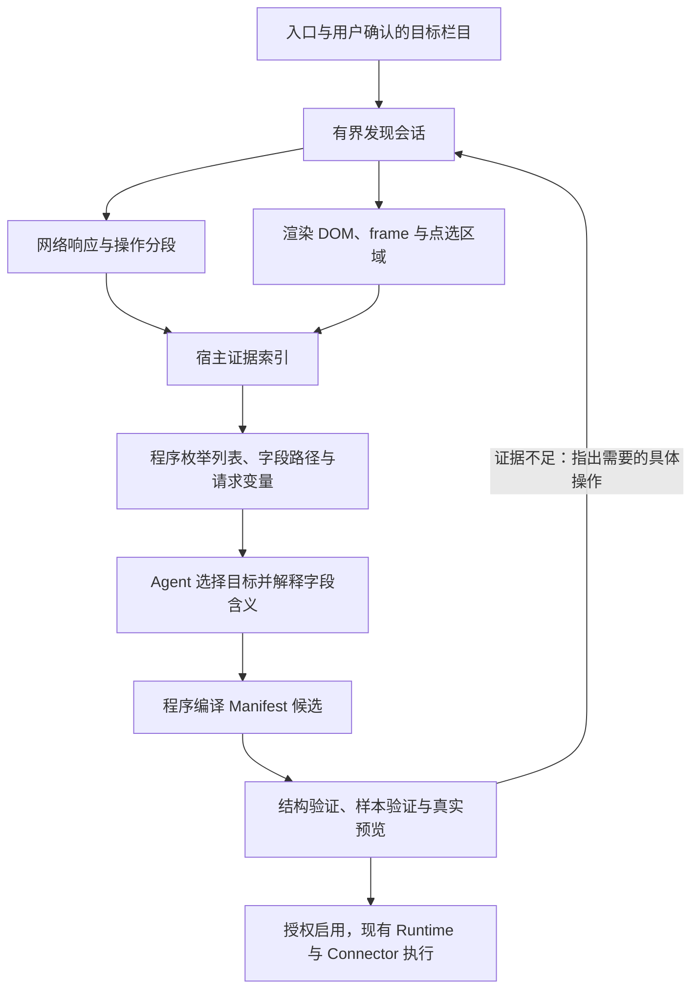

# 数据源发现与候选生成：架构评审与调整建议

日期：2026-10-28  
状态：分析建议，尚未实施；不替代 Intent、Architecture Spec 或现有 ADR。  
范围：当前工作区中的 HTTP 探测、引导录制、证据摘要、Manifest 候选与回放链路。

## 结论

用户反馈的主要失败点是“找不到真实接口或页面数据”。当前应优先改进**发现与证据表达**，再改候选生成。

建议将接入流程整理为：**真实交互采集证据 → 程序枚举结构 → Agent 解释语义 → 程序编译候选 → 分阶段验证**。让 Agent 选择已观察到的列表、字段和关联关系；URL、请求参数、JSON 路径和可用选择器尽量由宿主确定。

现有稳定内核、事件存储、Connector 和确定性调度仍适用。调整集中在 `academic-source-browser`、`academic-sources`、`academic-adapter-runtime` 及工具/UI 交接层，无需重建整个系统或为每个网站新增插件。

## 1. 当前链路与证据缺口

当前已有两条发现路径，不能将引导录制当成尚未存在的新功能：

- HTTP 路径：`academic_probe_source` / `academic_crawl_source` → 静态响应摘要 → Agent 手写 Manifest → 样本回放。
- 浏览器路径：UI“登录并录制” → Playwright 捕获响应 → 接口清单 → Agent 手写 Manifest → 样本回放。

引导录制已有本地真实浏览器测试记录；超星、智慧树的真实账号录制尚未验收。本评审没有使用这些平台的会话，不能归因到某个真实接口，也没有候选成功率统计。

| 问题 | 当前实现证据 | 对发现/生成的影响 |
|---|---|---|
| 静态响应与用户看到的页面不同 | `probe.ts` / `crawl.ts` 使用 `safeFetch`，没有执行页面 JavaScript；爬取只跟 GET 链接 | SPA 的列表与点击产生的接口无法由入口 HTML 直接获得 |
| 摘要省略结构位置 | `capture.ts` 的 `findArray` 最多向下查找两层，返回数组但不返回数组路径；`fieldsOf` 只描述第一行的直接字段 | Agent 看见 `courseId`，仍不知道列表在 `data.list` 还是其他位置，也不知道嵌套字段路径 |
| 只选择一个数组 | 先选当前层最长数组，再考虑下一层 | 筛选项、导航数据可能遮住真正的课程列表 |
| 内容在排序前被截断 | 浏览器录制有数量上限，摘要又先 `slice(0, 40)` 再评分 | 登录阶段的响应可能挤掉后续才打开的业务列表；提高模型能力无法恢复被丢弃的数据 |
| 缺少渲染后的页面证据 | 录制读取 `response.body()`，HTML 摘要主要是表头；没有列表 DOM 快照和行样本 | 没有 JSON 接口、数据只出现在渲染后 DOM 时缺少第二条提取路径 |
| 原始样本与清单容量不一致 | 录制默认最多 40 条，`ProbeSampleStore` 默认最多 30 条、TTL 60 分钟 | 默认配置下，一次录制超过 30 个不同样本就可能返回已经被淘汰的 `sampleId` |
| 请求发现与请求执行不等价 | 清单保留头名称，不保留可重放的认证绑定；Manifest 当前只支持 GET / 有限 JSON POST | 已找到接口仍可能因为表单、请求头、动态令牌或嵌套 body 无法运行；应报告能力缺口，避免继续猜接口 |
| 流程规则散落在提示词 | UI 提示在 SPA 无录制时继续探索脚本；工具描述要求停止猜测并转录制 | 实际路径依赖模型如何解读提示，宿主没有统一的发现状态与下一步判定 |

相关实现：

- [HTTP 探测](../packages/academic-sources/src/probe.ts)、[有界抓取](../packages/academic-sources/src/crawl.ts)
- [浏览器录制](../packages/academic-source-browser/src/index.ts)、[接口摘要](../packages/academic-sources/src/capture.ts)
- [样本库](../packages/academic-sources/src/sample-store.ts)、[候选工具输入](../packages/academic-agent-tools/src/tools.ts)
- [Manifest Schema](../packages/academic-adapter-runtime/src/manifest.ts)、[回放](../packages/academic-adapter-runtime/src/runtime.ts)

### 本轮做过的最小复现

直接调用当前 `buildCaptureSummary`，使用构造数据检查摘要，不访问真实平台：

| 输入 | 实际结果 |
|---|---|
| 列表位于 `data.payload.result.records` | 输出只剩 `data: object`，没有课程字段 |
| 根节点有 `filters` 数组，课程位于 `data.records` | 选择了 `filters`，课程字段丢失 |
| 前 40 个响应是普通数据，第 41 个才是课程接口 | 课程接口未进入摘要 |
| 普通 `data.list`，行内有 `details.due` | 能返回直接字段，但未提供列表路径和嵌套日期路径 |

这些复现证实了信息丢失，不能替代真实平台验收，也不能据此推算失败占比。

## 2. 可采用的其他探测方法

以下优先级是针对当前项目的工程建议，不代表已测得的成功率。

| 方法 | 适合情况 | 建议位置与局限 |
|---|---|---|
| 官方 API、日历订阅、平台导出 | 已有用户可访问的正式入口 | 发现入口时优先使用；没有真实入口就不增加空壳 engine |
| **带操作分段的浏览器网络录制** | SPA、点击课程后才加载列表、跨主机请求 | 主路径。给“打开课程列表”“打开作业”“翻页”分别标记时间段、页面与 frame，缩小目标响应范围 |
| **渲染后 DOM + frame 快照** | JSON 不可用、HTML 列表由 JS 生成、数据在 iframe 中 | 与网络证据同时采集；分析表格/重复卡片、文本、链接和属性。原始响应 HTML 与渲染 DOM 必须分开标记 |
| **用户点选一个列表或一行记录** | 多个列表相似、接口名称不直观、模型不知道目标栏目 | 用户只需指出“这是我要的作业列表”；程序反查重复结构与同一操作段内的响应，再让 Agent 判语义 |
| **翻页/切课前后的差分观察** | 页码、游标、课程参数不明确 | 比较实际请求和返回 ID 集合，提出参数绑定候选；时间接近或字段名相似本身不能证明关系 |
| 页面内嵌结构化数据 | 首屏数据嵌在 JSON script 中、没有独立 XHR | 静态解析合法 JSON，记录路径与来源；不执行从页面提取的任意脚本 |
| 本地 HAR 导入与回放 | 已有录制、内置录制不完整、需要复现问题 | 作为补充证据入口；HAR 可能含凭据，必须由宿主隔离解析和脱敏，不能整包交给模型或提交仓库 |
| JS 静态分析、源码映射 | 网络/DOM 证据仍不足，需寻找 API 线索 | 低优先级线索。字符串命中不算真实端点，更不能证明请求方法、参数或只读语义 |
| 视觉 Agent / OCR | 控件缺少语义、特殊渲染内容 | 最后辅助定位；截图无法可靠提供稳定 ID、请求契约与完整分页，不作为默认采集路线 |

Playwright 已支持网络事件与响应正文读取，现有项目也已依赖它，可以先扩展已有录制能力。[网络事件](https://playwright.dev/docs/network)、[Response.body](https://playwright.dev/docs/api/class-response#response-body)。

iframe 应被纳入页面结构采集；可访问性快照可辅助识别列表和按钮，但不能替代完整的字段/属性证据。[Frames](https://playwright.dev/docs/frames)、[ARIA snapshots](https://playwright.dev/docs/aria-snapshots)。

Service Worker 相关请求可能涉及 context 层事件和不同请求归属；应优先被动观察 context 层事件并记录来源，不能默认通过禁用 Service Worker 改变真实站点行为。[Service Workers](https://playwright.dev/docs/service-workers)。

## 3. 建议的新链路

### 3.1 有界发现会话

在已有 source 下维护一次发现操作的状态即可，不增加独立服务或另一套 Agent 框架：

- 记录目标数据类型、当前阶段、操作分段、证据引用、过期时间和唯一下一步。
- 用户登录后打开目标页面，采集网络与渲染 DOM；允许手动标记“当前是课程/作业列表”。
- 接口清单查询和补充结构查询只读取已捕获的证据，不需要重新访问网站，也不消耗网络探测额度。
- 选入候选的样本在会话有效期内固定保留；统一样本数量与字节预算。原始内容继续留在宿主并按 TTL 清理。
- 保留请求失败、被过滤、被截断的计数与原因；没有数据时能区分“没触发”“未捕获”“被过滤”“无法解析”。

### 3.2 结构化证据取代过度压缩的摘要

对 JSON 枚举多个数组节点，返回精确路径，例如 `data.records`；对多行采样，生成字段路径、类型、缺失情况和有限脱敏示例。深度、数量、字节都有明确上限，必要时通过工具按节点展开。

对 HTML 返回候选表格/重复卡片的结构引用、frame 路径、行数、少量脱敏行样本与经过查询验证的选择器。用户点选的区域优先。

保留 `endpointId` / `collectionId` / `fieldId` 等不透明引用。敏感 URL、请求体和认证参数留在宿主；Agent 使用引用选择，不负责重构被脱敏后的请求。

### 3.3 将结构生成与语义映射分开

程序负责生成请求描述、列表路径、可用选择器、字段候选及契约合法性。Agent 主要回答：

- 哪个列表对应课程、作业或考试？
- 哪个字段是稳定 ID、标题、课程关联与截止时间？
- 某个时间字段是截止、发布时间还是开始时间？证据不足时需要用户确认什么？

候选编译器只接受证据中存在的引用，生成当前 Schema 能表达的 Manifest。模型提出的语义映射仍需验证；样本里不存在的路径不能变成有效候选。

现有专家模式可保留手工 Manifest 输入；普通接入优先使用受限映射接口，减少模型一次性填写整份配置的负担。

### 3.4 明确区分“发现了数据”与“能持续同步”

把失败分为四类：

1. **采集缺口**：页面未打开、数据未加载、响应被丢弃。下一步是指定交互或重新捕获。
2. **结构/语义缺口**：路径不足、多个列表或日期字段含义不明。下一步是展开节点或点选确认。
3. **执行能力缺口**：表单编码、嵌套 JSON body、认证头、动态令牌等当前 Runtime 无法表达。返回明确的 `UNSUPPORTED_TRANSPORT` 等诊断，停止反复生成候选。
4. **验证覆盖缺口**：只有一门课或一页样本，尚未覆盖候选声明的请求。指出缺少的请求/分页证据。

只保存 Cookie 无法覆盖所有网站认证方式；Playwright 的认证文档还涉及 localStorage、IndexedDB，sessionStorage 需要单独处理。这只能说明可能存在能力缺口，不能证明当前失败网站采用了哪一种方式。[认证状态文档](https://playwright.dev/docs/auth)。

若未来扩展浏览器上下文执行或认证绑定，应先以真实接口证明需要，再新增受控契约和 ADR；秘密仍经 Vault 管理。不能直接把 Playwright 请求客户端作为绕过现有出口校验的替代品。

### 3.5 保留严格验证，同时让验证能逐步推进

- **结构发现成功**：证实某个列表与字段确实存在，不授予启用资格。
- **局部提取通过**：在选定样本上解析一个列表；便于尽早发现错误映射，不要求此时抓齐全部课程。
- **候选回放通过**：保留现有 Schema、契约、权限与完整请求覆盖要求；局部通过不能冒充 `validated`。
- **真实预览通过**：以当前会话执行并核对来源、课程归属、稳定 ID、时间精度与样本记录。
- **启用与重复同步检查**：继续走现有授权、Command 和去重路径。

现有 URL + method + body 精确匹配不应改成模糊匹配以“提高通过率”。脱敏、临时令牌和序列化差异需要在宿主的显式请求绑定层解决，并显示真实证据覆盖程度。[HAR 回放能力](https://playwright.dev/docs/mock)。

## 4. 包职责与实施顺序

| 位置 | 建议职责 |
|---|---|
| `academic-contracts` | 发现阶段、证据引用、列表/字段描述、映射输入、失败诊断；不持有浏览器对象 |
| `academic-source-browser` | 浏览器生命周期、操作标记、网络/context 事件、渲染 DOM/frame 采集与点选 |
| `academic-sources` | 有界发现流程、证据索引、列表枚举、请求差分、TTL/预算与下一步判定 |
| `academic-adapter-runtime` | 映射编译、兼容性检查、局部提取验证、现有完整回放与确定性执行 |
| `academic-agent-tools` / DSH 适配 | 读取证据、选择映射、查询验证结果；复用 DSH Agent，不新建 Harness |
| `academic-dsh-ui` | 登录、选择目标栏目、标记操作、确认映射与启用；由宿主返回下一步 |
| Kernel / Storage / Connector / Scheduler | 保留现有领域与一致性职责；发现证据属于运营状态，不进入学业事件流 |

**第一步：补齐当前证据链。** 修复数组枚举和路径丢失、样本预算不一致、先截断再排序；统一 SPA 的下一步策略，增加过滤/截断诊断。先让已经观察到的数据完整可用。

**第二步：增加操作分段与渲染 DOM。** 课程列表、作业列表、翻页分别采集；点选列表作为歧义消除手段。引导录制成为 SPA 的默认入口，HTTP 探测继续服务静态页面和已知接口。

**第三步：增加映射编译器。** 用证据引用生成请求和路径，让 Agent 只承担语义判断；增加局部验证。发现不受支持的传输时，先形成真实样本和能力报告，再决定是否扩展 Runtime。

**第四步：再接自修复。** 先有可重复的发现与验证，再让结构变化触发有界诊断。认证失效交回用户，网络暂错由已有调度重试；不能把所有失败都升级成 Agent 重新探索。

## 5. 如何判断调整是否有效

先记录同一组真实接入任务的基线，再比较调整后的结果，不预设成功率：

- 用户在浏览器能看到列表时，宿主是否能返回至少一个对应的列表证据？
- 发现失败能否明确归入“未触发/漏捕获/结构缺失/执行不支持”？
- 可见列表是否带精确路径、可检查字段和仍有效的样本引用？
- 两页、两门课程的观测能否支撑分页与课程关联，而非仅匹配字段名？
- 从采集到首次有效提取，需要多少模型调用、网络探测和用户操作？
- 回放通过后，真实预览能否正确取得预期记录，重复同步是否无新增？

回归样本至少包含：静态表格、SPA JSON、深层数组、多个并列数组、iframe、分页、空列表、噪声响应先到、样本淘汰，以及 Runtime 明确不支持的请求。

首要验收目标是：**用户已经看见的数据，系统能指出它来自哪里、结构是什么、能否持续读取；证据不足时给出具体下一步。** 这一步稳定后，自适应与后续自迭代才有可靠基础。
